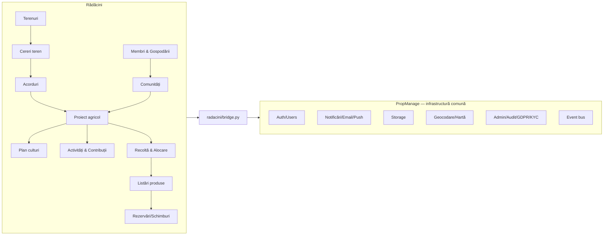

# Rădăcini × PropManage — audit de reutilizare pentru platforma agro-colaborativă

Branch: `radacini` · Data: 2026-10-13 · Etapa: **audit și arhitectură. Nu s-a implementat nimic.**

**Ce înseamnă etichetele**
- **CONFIRMAT** — văzut direct în cod. Comportamentul la rulare nu l-am testat, cu excepția autentificării și a modulului Rădăcini.
- **PARȚIAL CONFIRMAT** — există, dar nu face tot ce sugerează numele.
- **NECONFIRMAT** — apare doar în nume sau documentație.
- **LIPSĂ** — nu există.
- **NECESITĂ VALIDARE** — trebuie testat la rulare sau verificat de un jurist.

> **Erată (2026-10-13, reverificare la nivel de effort ridicat).** Auditul inițial a fost făcut la effort mediu. O reverificare cu dovezi din cod a găsit afirmații greșite sau imprecise, corectate mai jos în text (marcate *[corectat]*):
> - **Evenimentele `radacini.*` NU apar automat în admin.** `event_bus.emit` scrie doar în `activity_events` (`event_bus.py:60-77`). Activitate Live citește `db.events` (`routes/admin_console.py:700`), User Timeline agregă din users/requests/payments/reviews, Notification Center din `command_center_recos`/`audit_anomalies`, iar Automation Center are 3 șabloane fixe. Integrarea cere cod: o filă/sursă Rădăcini.
> - **Acțiunile Rădăcini NU ajung în `admin_actions_log`.** Trebuie apelat explicit `admin_console.audit()` (`admin_audit_log`) sau `sub_admin_deps._log_action`.
> - **Scope-urile sub-adminilor sunt aplicate de un middleware global** (`middleware_scope.py`, ~30 de prefixe `/api/admin/*`), plus `require_admin_scope` în 3 fișiere. Prefixele nemapate trec pentru orice sub-admin, iar `/api/radacini/*` nu e acoperit.
> - **Tabelele `app.radacini_*` nu sunt create prin migrație.** `pgmongo` le creează la prima scriere (`pgmongo.py:783-852`), doar cu index GIN, fără indexuri pe expresii.
> - **Escrow:** doar `requests.py:294` e un flag demo. `routes/payments.py` încasează real prin Stripe Checkout (când cheile sunt reale), iar `projects.py` are tranșe din wallet. Eliberarea e doar evidență internă (`wallet_balance`), fără payout.
> - **Admin:** 15 secțiuni (10 business, 5 infra), 113 intrări (`AdminLayoutMetronic.jsx:90-330`). „Joburi programate” e intrare în Dashboard Business.
> - **Alte precizări:** `models.py` nu are `ROLES` (are `PUBLIC_REGISTER_ROLES`). KC verifică fondatorul la `knowledge_center.py:171`. KYC permite upload doar specialiștilor. Exportul GDPR nu include colecțiile Rădăcini. Quest-urile sunt legate de vouchere și de rolurile client/specialist. XOS are doar suprafața `client_home`. `service_contracts.py` are semnătură pentru ambele părți și mediere de operator. Rate limiting-ul se aplică doar pe `/api/public`, `/api/p`, `/api/track`, `/api/go`.

---

## 1. Rezumat executiv

- PropManage are o **infrastructură comună bună de refolosit**: autentificare (Supabase și sesiune), administrare și jurnal de audit, notificări pe email/in-app/push, stocare de fișiere, geocodare Google, hartă Leaflet, GDPR, KYC, forum de comunitate și un motor de quest-uri. Rădăcini se poate sprijini direct pe ele.
- **Partea de business din PropManage (marketplace, cereri, proiecte, escrow, abonamente) e construită pentru servicii pentru casă.** Se pot refolosi *tiparele*, nu modulele ca atare.
  - Marketplace-ul pune specialiști să concureze pe o cerere, nu vinde produse.
  - Escrow-ul: banii pot intra real prin Stripe Checkout, dar „eliberarea” e doar evidență internă în wallet, fără payout; pe cereri (`requests.py:294`) e doar un flag demo. *[corectat]*
  - Abonamentul e o plată unică ce prelungește accesul cu N zile; nu e recurent.
  - Proiectele pot fi create doar de un designer.
- **Recomandare:** domeniul agricol stă într-un modul separat, `radacini` (colecții `radacini_*`, rute `/api/radacini/*`), în aceeași aplicație. Infrastructura comună se folosește printr-un singur punct de legătură, `bridge.py`. **Fără microservicii.**
- **MVP-ul propus:** Membri, Terenuri, Cerere → Acord, Proiect agricol (plan + activități + contribuții), Recoltă și distribuție, Schimb/vânzare simplă **fără plăți online**. Pilot în județul Cluj.
- **Amânate:** plăți și abonament online, investiții colective, gamification extinsă, logistică.

---

## 2. Arhitectura PropManage identificată

| Strat | Ce am găsit | Dovezi | Status |
|---|---|---|---|
| Frontend | Next.js App Router, care găzduiește aplicația SPA cu React Router; Tailwind + shadcn | `frontend/app/[...slug]`, `frontend/src/App.js`, `src/components/ui/*`, `src/design-system/` | CONFIRMAT |
| Backend | FastAPI, monolit modular: ~186 de module de rute înregistrate centralizat | `backend/routes/register.py`, `backend/server.py` | CONFIRMAT |
| Date | Supabase Postgres, schema `app`, câte un tabel JSONB `(id, data)` pentru fiecare colecție; un strat compatibil Motor/Mongo (`pgmongo`) | `supabase/migrations/20261009120000_app_collections.sql`, `backend/pgmongo.py` | CONFIRMAT |
| Integritate | **Fără chei străine (FK) și fără constrângeri relaționale**: totul e verificat în cod. RLS e activ, fără politici; doar backend-ul are acces. | migrația de mai sus | CONFIRMAT |
| Interogări geografice | **Lipsă**: nu există PostGIS și `$geoNear` nu e suportat nativ (se încarcă tot documentul) | `pgmongo.py:288` | CONFIRMAT (limitare) |
| Deploy | Backend pe Railway, frontend pe Cloudflare Workers (OpenNext) | `backend/Dockerfile`, `frontend/wrangler.jsonc` | CONFIRMAT |
| Teste | 224 de fișiere pytest; 192 dintre ele rulează pe HTTP contra unui server pornit (integrare, nu unitare) | `backend/tests/` | CONFIRMAT · nu le-am rulat |

---

## 3. Inventarul componentelor refolosibile

| Componentă | Ce face real | Dovezi | Status |
|---|---|---|---|
| Autentificare | Supabase Auth, cookie httpOnly, Google OAuth, `get_current_user` | `deps.py:27`, `supabase_auth.py`, `routes/auth.py` (46 endpoint-uri) | CONFIRMAT, testat local |
| Roluri | **Un singur rol pe utilizator** (`user.role`), plus un mecanism „dual-role” limitat la specialist↔client; `require_role(*allowed)` | `deps.py:75-87`, `models.py:9` (`PUBLIC_REGISTER_ROLES`) *[corectat]*, `tests/test_phase52_multirole.py` | CONFIRMAT · **nu acoperă rolurile multiple din agro** |
| Administratori delegați și aprobări | sub-admini, aprobări, `admin_actions_log` | `routes/sub_admins.py`, `routes/admin_approvals.py` | CONFIRMAT |
| Multi-tenant | registru `tenants` și rezolvarea tenantului pe fiecare request; fără migrare de date | `backend/tenancy.py`, `routes/tenants.py` | PARȚIAL CONFIRMAT |
| Hartă | `PmMap`: Google sau, ca rezervă, Leaflet; **doar markere** | `frontend/src/components/PmMap.jsx`, `views/PropertyGIS.jsx` | CONFIRMAT · fără poligoane |
| Geocodare | Google Geocoding cu clasificarea rezultatelor | `backend/geocoding.py`, `routes/geocoding.py`, `tests/test_geocoding_iter229.py` | CONFIRMAT |
| Zone România | listă de țară/oraș/cartier, inclusiv cartierele din Cluj-Napoca | `backend/romania_zones.py:34`, `routes/regions.py` | CONFIRMAT · urban, nu rural |
| Notificări | in-app (`notifications`), email prin Resend, push | `routes/notifications.py`, `email_service.py:121`, `services.py` | CONFIRMAT |
| Chat | mesaje legate de un `request` | `routes/chat.py` | CONFIRMAT · legat de cereri |
| Comunitate | forum: subiecte, răspunsuri, aprecieri, categorii | `routes/community.py` | CONFIRMAT |
| Fișiere | Supabase Storage, bucket-ul `propmanage-files` | `storage_client.py`, `routes/storage.py` | CONFIRMAT |
| Marketplace | specialiști care fac oferte pe o cerere a clientului (credite de lead, ranking, „sponsorizat”) | `routes/marketplace_offers.py`, `routes/marketplace.py` | CONFIRMAT · **servicii, nu produse** |
| Cereri (requests) | `open → confirmed → in_progress → completed`, recenzie | `routes/requests.py` | CONFIRMAT |
| Matching | filtru după categorie și zonă pentru specialiști | `routes/matching.py` (1 endpoint, 86 de linii) | CONFIRMAT · simplu |
| Proiecte | membri, sarcini, comentarii, atașamente, milestone-uri; **create doar de designer** | `routes/projects.py:1-9` (22 de endpoint-uri) | CONFIRMAT |
| Escrow | pe cereri, doar flag demo (`requests.py:293-302`); încasare reală prin Stripe Checkout (`routes/payments.py:28-190`) și tranșe din wallet pe proiecte (`projects.py:432-590`); eliberarea e doar evidență internă, fără payout *[corectat]* | idem | PARȚIAL CONFIRMAT |
| Plăți | Stripe Checkout `mode: payment` (plată unică) | `stripe_checkout.py:81-100`, `routes/payments.py` | CONFIRMAT |
| Abonamente | plată unică pentru N zile de acces (`hh_subscriptions.expires_at`); **nu se reînnoiește automat** | `routes/house_health_billing.py:1-10,202-211` | CONFIRMAT |
| Portofel | `transactions` / `payment_transactions` | `routes/wallet.py`, `tests/test_sec02_direct_wallet_topup.py` | PARȚIAL CONFIRMAT |
| Recenzii | recenzii legate de cereri | `routes/reviews_v2.py` | CONFIRMAT |
| Dispute | dispute legate de cereri și tranzacții | `routes/disputes.py` | CONFIRMAT |
| Contracte | contracte de servicii, șabloane juridice | `routes/service_contracts.py`, `legal_templates.py`, `routes/legal.py` | CONFIRMAT · neadaptate pentru agro |
| KYC | flux de verificare a identității specialistului cu documente | `routes/kyc.py` | CONFIRMAT |
| GDPR | ROPA, DPIA, DSAR, jurnal de audit | `routes/gdpr.py` (20 de endpoint-uri) | CONFIRMAT |
| Gamification | quest-uri definite de admin, progres, vouchere | `routes/feature_configurator.py:1-27` | CONFIRMAT |
| Niveluri / progresie | niveluri comerciale ale specialiștilor și comisioane | `routes/experience_tiers.py`, `specialist_progression.py` | CONFIRMAT · nu se potrivesc |
| Calendar | sarcini de mentenanță pe proprietate | `routes/maintenance_calendar.py` | CONFIRMAT |
| Bus de evenimente | emitere canonică de evenimente în `activity_events` | `backend/event_bus.py` | CONFIRMAT |
| Limitare de trafic (rate limit) | ținută în memorie, per proces | `backend/rate_limit.py` | CONFIRMAT · nu e distribuită |
| Modulul Rădăcini | `/api/radacini/health`, `/api/radacini/me`, `bridge.py`, interfața `/radacini` | `backend/routes/radacini/`, `frontend/src/apps/radacini/` | CONFIRMAT, testat local |

---

## 4. Matricea de reutilizare

| Funcționalitate agricolă | Componentă PropManage | Dovezi | Modificări necesare | Riscuri | Decizie |
|---|---|---|---|---|---|
| Cont, autentificare | Supabase Auth + `get_current_user` | `deps.py` | niciuna | — | **Reutilizare directă** |
| Roluri neexclusive (cultivă/consumă/oferă teren…) | `user.role` | `deps.py:75` | **nu schimbăm `role`**; ținem interesele într-o colecție `radacini_members.interests[]` | dacă am atinge `role`, s-ar strica PropManage | **Dezvoltare nouă** (strat peste autentificare) |
| Gospodărie / cont de familie | — | — | `radacini_households`, cu membri | consimțământ pentru minori | **Dezvoltare nouă** |
| Profil | `PATCH /auth/profile` | `routes/auth.py` | câmpurile agro stau în `radacini_members` | — | **Adaptare** |
| Registru de terenuri | `properties` (apartamente/case, legate de twin) | `routes/properties.py` | **nu folosim `properties`**: aduce după el twin, pașaport și house-health | ar polua PropManage | **Dezvoltare nouă** `radacini_parcels` |
| Hartă terenuri | `PmMap` (markere) | `PmMap.jsx` | poligoane GeoJSON (react-leaflet le suportă deja); straturi | precizia datelor cadastrale | **Adaptare** |
| Geocodare | `geocoding.py` | idem | parametri pentru zone rurale (comune, sate) | costul API-ului Google | **Reutilizare directă** |
| Căutare după distanță | — | `pgmongo.py:288` | filtru simplu pe lat/lng pentru pilot; PostGIS mai târziu | performanță la volum mare | **Amânare** (PostGIS) |
| Zone Cluj (rural) | `romania_zones.py` (urban) | `:34` | listă cu comunele din Cluj | — | **Adaptare** |
| Cereri de teren | `requests` (servicii) | `routes/requests.py` | refolosim tiparul de stări, nu colecția | stările nu se potrivesc | **Dezvoltare nouă** (același tipar) |
| Matching teren ↔ cultivator | `matching.py` | 86 de linii | regulă nouă: distanță, suprafață, tip de cultură | — | **Dezvoltare nouă** (simplu) |
| Acorduri | `service_contracts`, `legal_templates` | idem | șabloane pentru arendă, cultivare la parte, sumă fixă | **juridic** | **Adaptare**, după validarea unui jurist |
| Proiect agricol, membri, sarcini | `projects` (designer-led) | `projects.py:1-9` | crearea e blocată pe designer; milestone-urile au escrow | dacă îl modificăm, afectăm designerii | **Adaptare (copiem tiparul)** în `radacini_projects`; nu modificăm `projects` |
| Planificare culturi și rotație | — | — | entități noi | — | **Dezvoltare nouă** |
| Zile de lucru, calendar | `maintenance_calendar` | idem | tiparul de interfață și de date | — | **Adaptare** |
| Evidența contribuțiilor | `transactions` (bani) | `wallet.py` | registru separat, care nu e monetar: muncă, materiale, teren | să nu fie confundat cu bani | **Dezvoltare nouă** |
| Recoltă și alocare | — | — | entități noi | promisiuni de producție | **Dezvoltare nouă** |
| Marketplace alimentar | `marketplace_offers` (servicii) | `:1-10` | modelul de business e altul | credite de lead / taxe nepotrivite | **Nerecomandată** reutilizarea; **dezvoltare nouă**, simplă |
| Schimb / barter | — | — | „echivalent de schimb” informativ, fără valoare transferabilă | fiscal și juridic | **Dezvoltare nouă**, limitată |
| Comenzi și livrări | `verified_estate_orders` (alt domeniu) | `verified_estate.py` | — | — | **Amânare** (MVP: ridicare personală) |
| Recenzii | `reviews_v2` (legat de cereri) | idem | `target_type` generic sau colecție proprie | — | **Adaptare** |
| Dispute | `disputes` | idem | legate de comenzi și acorduri agro | — | **Amânare** |
| Abonament 5 €/lună | `hh_subscriptions` + Stripe pentru plată unică | `house_health_billing.py` | tiparul „plată = N zile”; pentru recurență e nevoie de Stripe Billing | facturare, TVA | **Amânare** (pilot gratuit sau plată manuală) |
| Plăți între membri | Stripe Checkout | `stripe_checkout.py` | — | **juridic** (intermediere de plăți) | **Nerecomandată** în MVP |
| Escrow | flag demo | `requests.py:293` | — | nu mută bani | **Nerecomandată** |
| Token / monedă internă | — | — | — | **juridic** | **Nerecomandată** |
| Investiții colective | — | — | — | ASF, crowdfunding, fiscal | **Amânare** |
| Notificări | `notifications` + email + push | `email_service.py` | șabloane noi | — | **Reutilizare directă** |
| Chat | `chat` (pe cereri) | `chat.py` | context generic: proiect, ofertă | — | **Adaptare** |
| Forum comunitate | `community` | idem | categorie sau grup per comunitate | moderare | **Adaptare** |
| Gamification | quest-uri + vouchere | `feature_configurator.py` | quest-uri sezoniere; **fără vouchere** (au valoare) | să nu se amestece punctele cu drepturile | **Adaptare** (fază 2) |
| Niveluri / insigne | `experience_tiers`, `tier_milestones` | idem | sunt comerciale (comisioane) | se amestecă cu economicul | **Nerecomandată**; insigne noi, pur educaționale |
| Verificare proprietar teren | `kyc` | `kyc.py` | tip de document nou: extras CF / dovada dreptului de folosință | date sensibile | **Adaptare** |
| GDPR | `gdpr` | idem | intrări ROPA noi: locație, minori | — | **Adaptare** |
| Administrare și audit | admin console, `admin_actions_log`, sub-admini | idem | o secțiune Rădăcini | — | **Reutilizare directă** |
| Fișiere (poze, documente) | Supabase Storage | `storage_client.py` | prefix de cale `radacini/` | egress (vezi riscurile) | **Reutilizare directă** |
| Evenimente / jurnal de activitate | `event_bus` | idem | tipuri de evenimente `radacini.*` | — | **Reutilizare directă** |

---

## 5. Arhitectura agricolă propusă

Monolit modular în aplicația existentă. Domeniul agricol e izolat; infrastructura comună e folosită doar prin `bridge.py`.

| # | Modul | MVP? | Pe ce se bazează |
|---|---|---|---|
| 1 | Identity & Membership | **Da** | autentificarea PropManage (direct) + `radacini_members`, `radacini_households` |
| 2 | Land Registry | **Da** | nou + `PmMap` adaptat + geocodare + KYC adaptat |
| 3 | Agricultural Communities | **Da** (simplu) | nou + forumul `community` adaptat |
| 4 | Projects & Agreements | **Da** | tiparul `projects` copiat + șabloane juridice adaptate |
| 5 | Crop Planning | **Da** (minim) | nou |
| 6 | Work Coordination | **Da** | nou + tiparul calendarului |
| 7 | Harvest & Allocation | **Da** | nou |
| 8 | Food Marketplace | **Da** (listări + rezervare, fără plată online) | nou |
| 9 | Barter & Exchange | Parțial (ofertă de schimb, fără sold) | nou |
| 10 | Orders & Logistics | Nu (ridicare personală) | amânat |
| 11 | Shared Investment Projects | Nu | amânat (juridic) |
| 12 | Gamification & Education | Nu (doar evenimente / zile de lucru) | quest-urile, mai târziu |
| 13 | Administration & Audit | **Da** | admin + audit (direct) |

---

## 6. Modelul conceptual de date

Toate colecțiile sunt de forma `radacini_*`: tabele JSONB `app.radacini_*`. **Azi le creează `pgmongo` la prima scriere, doar cu index GIN** *[corectat]*; trebuie adăugată o migrație (`supabase/migrations`) cu `app.create_collection` și indexuri pe expresii JSONB pentru câmpurile filtrate. **Nu au FK**: integritatea se verifică în serviciul `radacini`. Istoricul se păstrează ca evenimente, cu soft-delete (`archived_at`).

| Entitate | Câmpuri cheie | Relații / cardinalitate | Reguli de acces |
|---|---|---|---|
| `radacini_members` | `user_id` (unic), `interests[]` (grow/consume/land/sell/exchange/invest), `county`, `locality`, `visibility` | 1:1 cu `users` | proprietarul; adminul |
| `radacini_households` | `name`, `owner_member_id`, `members[{member_id, relation, is_minor}]` | 1:N membri | proprietarul gospodăriei |
| `radacini_communities` | `name`, `area`, `coordinators[]`, `rules` | N:M membri (prin `radacini_community_members`) | membrii văd; coordonatorii administrează |
| `radacini_parcels` | `owner_member_id`, `area_m2`, `geometry` (GeoJSON), `locality`, `access`, `water_sources[]`, `current_crops[]`, `availability{from,to}`, `verification_status`, `visibility` (public aproximativ / exact pentru parteneri) | 1:N oferte | proprietarul; locația exactă e vizibilă doar după acord |
| `radacini_land_offers` | `parcel_id`, `models[]` (arendă/parte din recoltă/sumă fixă/mixt/vânzare/proiect comun), `terms`, `status` | N:1 parcelă; 1:N cereri | public (rezumat) |
| `radacini_land_requests` | `offer_id`, `requester_member_id`, `proposal`, `status` | N:1 ofertă | solicitantul + proprietarul |
| `radacini_agreements` | `request_id`, `parties[]`, `model`, `terms_snapshot`, `version`, `status`, `signed_at[]`, `document_id` | 1:1 cerere acceptată; 1:1 proiect | doar părțile semnatare |
| `radacini_projects` | `agreement_id`, `parcel_id`, `community_id?`, `season`, `status` | 1:N participanți, culturi, activități | participanții |
| `radacini_project_members` | `project_id`, `member_id`, `role_in_project` (coordinator/cultivator/proprietar/voluntar) | N:M | participanții |
| `radacini_crop_plans` | `project_id`, `crop`, `area_m2`, `sow_date`, `expected_yield_kg` (estimare, nu garanție), `rotation_prev` | N:1 proiect | participanții |
| `radacini_activities` | `project_id`, `type` (plantare/întreținere/recoltare/zi de lucru), `date`, `slots`, `status` | N:1 proiect; 1:N contribuții | participanții |
| `radacini_contributions` | `project_id`, `member_id`, `kind` (muncă ore/materiale/bani/teren), `amount`, `unit`, `confirmed_by` | N:1 proiect; doar adăugare (append-only) | cel care o face + coordonatorul confirmă |
| `radacini_harvests` | `project_id`, `crop`, `quantity_kg`, `measured_by`, `date` | N:1 proiect; 1:N alocări | participanții |
| `radacini_allocations` | `harvest_id`, `member_id`, `quantity_kg`, `basis` (regula din acord) | N:1 recoltă | participanții |
| `radacini_listings` | `seller_member_id`, `product`, `qty`, `unit`, `price_ron?`, `exchange_for?`, `pickup_point`, `status` | 1:N rezervări | public |
| `radacini_reservations` | `listing_id`, `buyer_member_id`, `qty`, `mode` (bani la ridicare / schimb), `status`, `rating?` | N:1 listare | cumpărătorul + vânzătorul |
| `radacini_decisions` | `scope` (proiect/comunitate), `question`, `options`, `votes[]`, `result` | N:1 | membrii comunității sau proiectului |
| Audit | `activity_events` (bus); jurnalul admin (`admin_audit_log`) doar prin apel explicit *[corectat]* | — | admin |

**Nu duplicăm:** utilizatorii, fișierele, notificările, auditul, KYC și GDPR rămân cele existente.

**Separare obligatorie:** `contributions`, `agreements` și `allocations` sunt drepturi și evidențe. Punctele de gamification, când vor exista, vor sta într-o colecție separată și nu vor fi citite niciodată de logica economică.

---

## 7. Fluxurile principale (pe scurt)

| Flux | Stări | Cine poate acționa | Validări și conflicte |
|---|---|---|---|
| A. Publicare teren | `draft → pending_verification → published → paused/archived` | proprietarul; adminul verifică | suprafață > 0, geometrie validă în România; dovada dreptului de folosință (KYC adaptat); locația exactă e ascunsă public |
| B. Cerere de folosire | `sent → viewed → negotiating → accepted/declined/expired` | cultivatorul trimite, proprietarul răspunde | fără cereri duplicate active pe aceeași ofertă; disponibilitatea nu se suprapune cu un acord activ |
| C. Acord → proiect | `draft → proposed → signed_by_all → active → completed/terminated` | părțile | termenii se îngheață ca snapshot cu versiune; orice modificare = versiune nouă, semnată din nou; proiectul pornește doar la `signed_by_all` |
| D. Plan culturi | `planned → sown → growing → harvested` | coordonatorul și cultivatorii | suma suprafețelor ≤ suprafața parcelei; avertisment de rotație |
| E. Activități și contribuții | activitate: `scheduled → done/cancelled`; contribuție: `logged → confirmed/disputed` | membrii o înregistrează, coordonatorul o confirmă | doar adăugare; corecțiile se fac prin înregistrări de corecție |
| F. Recoltă și distribuție | `measured → allocated → distributed` | coordonatorul măsoară; membrii confirmă primirea | suma alocărilor ≤ recolta; regula de împărțire vine din acord |
| G. Vânzare / schimb | listare `active → reserved → completed/cancelled`; rezervare `requested → confirmed → picked_up/no_show` | vânzătorul și cumpărătorul | cantitatea rezervată ≤ disponibilul (scădere atomică); fără plată online în MVP |
| H. Abonament | (amânat) `trial → active → expired` | membrul | tiparul `hh_subscriptions`; recurența cere Stripe Billing și o decizie fiscală |
| I. Investiție colectivă | (amânat) | — | necesită aviz juridic (ASF / asociere / coproprietate) |

---

## 8. Riscuri

**Tehnice**
- Stratul `pgmongo` încarcă documentele candidate în memorie, iar egress-ul Supabase e deja peste cotă (vezi `e45e4cb`). Rădăcini trebuie să folosească filtre simple, indexate, paginare și **fără blob-uri în JSONB**.
- Fără FK, integritatea relațională depinde de cod. Trebuie scăderi atomice pentru cantități și teste pentru fiecare tranziție de stare.
- Nu există interogări geografice. Pentru pilot ajunge un filtru pe lat/lng; la scară mare e nevoie de PostGIS și de o migrație.
- Un singur rol pe utilizator: un cont agro e un utilizator `client` plus profilul `radacini_members`. Admin-ul și `require_role` rămân neschimbate.
- Limitarea de trafic e ținută în memorie și nu protejează corect dacă rulează mai multe instanțe.
- Testele existente sunt de integrare pe HTTP. Pentru Rădăcini recomand teste de serviciu și teste de API separate.

**Juridice (NECESITĂ VALIDARE de către un jurist)**
- Arenda are formă scrisă și, din câte știu, trebuie înregistrată la consiliul local. Acordurile generate de platformă trebuie verificate de un jurist.
- Vânzarea de alimente de către persoane fizice poate cere înregistrare sanitar-veterinară (DSV) și statut de producător. Același lucru e de verificat pentru barter și fiscalitatea schimburilor.
- Intermedierea de plăți și escrow-ul real pot intra sub reglementarea serviciilor de plată. De aceea MVP-ul nu are plăți între membri.
- Investițiile colective pot intra sub reglementarea ASF sau crowdfunding.
- GDPR: locația terenurilor e o dată personală. Pentru minori e nevoie de consimțământ parental.

---

## 9. Definiția MVP-ului (pilot în județul Cluj)

Ciclul demonstrat: **proprietar → teren publicat → cerere a cultivatorului → acord semnat în platformă → proiect → plan + activități + contribuții → recoltă măsurată → alocare → listare / rezervare / schimb, cu ridicare personală.**

În afara MVP-ului: plăți online, abonament încasat, livrări, investiții, puncte și niveluri, PostGIS.

---

## 10. Backlog inițial (epic-uri)

| Epic | Story-uri principale | Depinde de | Estimare orientativă* |
|---|---|---|---|
| E0 Fundație | migrație pentru colecțiile `radacini_*` și indexuri; serviciu + teste; secțiune admin; tipuri de evenimente | — | 3–4 zile |
| E1 Membri | onboarding cu interese; gospodărie; profil; ROPA GDPR | E0 | 3–4 zile |
| E2 Terenuri | CRUD parcelă; poligon pe hartă; verificare (KYC adaptat); ofertă cu modele | E0, E1 | 6–8 zile |
| E3 Cereri și acorduri | cerere; negociere (chat adaptat); acord cu versiune și snapshot; semnare | E2 | 6–8 zile |
| E4 Proiect agricol | membri; plan de culturi; activități și calendar; contribuții | E3 | 7–9 zile |
| E5 Recoltă | măsurare; alocare după regula din acord; confirmare | E4 | 3–4 zile |
| E6 Piață locală | listări; rezervări cu scădere atomică; schimb; evaluare | E1 | 5–6 zile |
| E7 Comunități | grupuri locale; forum adaptat; zile de lucru | E1 | 3–4 zile |
| E8 Pilot Cluj | comunele din Cluj; date demo; ghid; feedback | toate | 3 zile |

*Estimările sunt în zile de dezvoltare cu asistență AI, cu un singur dezvoltator. **Totalul e de aproximativ 39–50 de zile.** E o ipoteză, nu un angajament.

Costuri de infrastructură suplimentare pentru pilot: aproape zero, pentru că Supabase, Railway și Cloudflare există deja. Costuri variabile: Google Geocoding/Maps (de verificat la volumul pilotului), email Resend (în planul actual) și consultanță juridică (cost separat, de estimat).

---

## 11. Decizii care cer aprobarea ta

1. **Modul în aceeași aplicație** (recomandat) sau aplicație separată.
2. **Fără plăți și fără abonament încasat în MVP.** Pilotul e gratuit sau cu plăți manuale, în afara platformei.
3. **Terenurile într-o colecție nouă** (`radacini_parcels`), nu în `properties`.
4. **Proiecte agricole noi** (copiem tiparul), fără să modificăm `projects` din PropManage.
5. **Conturile:** aceleași conturi PropManage (rol `client` + profil Rădăcini), sau un rol nou?
6. **Locația terenului:** aproximativă în public și exactă doar după acord.
7. **Consultanța juridică** (arendă, vânzare de alimente, barter, GDPR minori) înainte de E3 și E6.
8. **Gamification amânată** în faza 2; MVP-ul are doar evenimente și zile de lucru.
9. **Ordinea epic-urilor** și dacă vrei un prototip de interfață (machete) înainte de backend.

**Următorul pas, după aprobare:** fazele 3–5 în detaliu (constrângeri, contracte API, permisiuni pe endpoint, pagini și criterii de acceptare) pentru epic-urile E0–E2.
